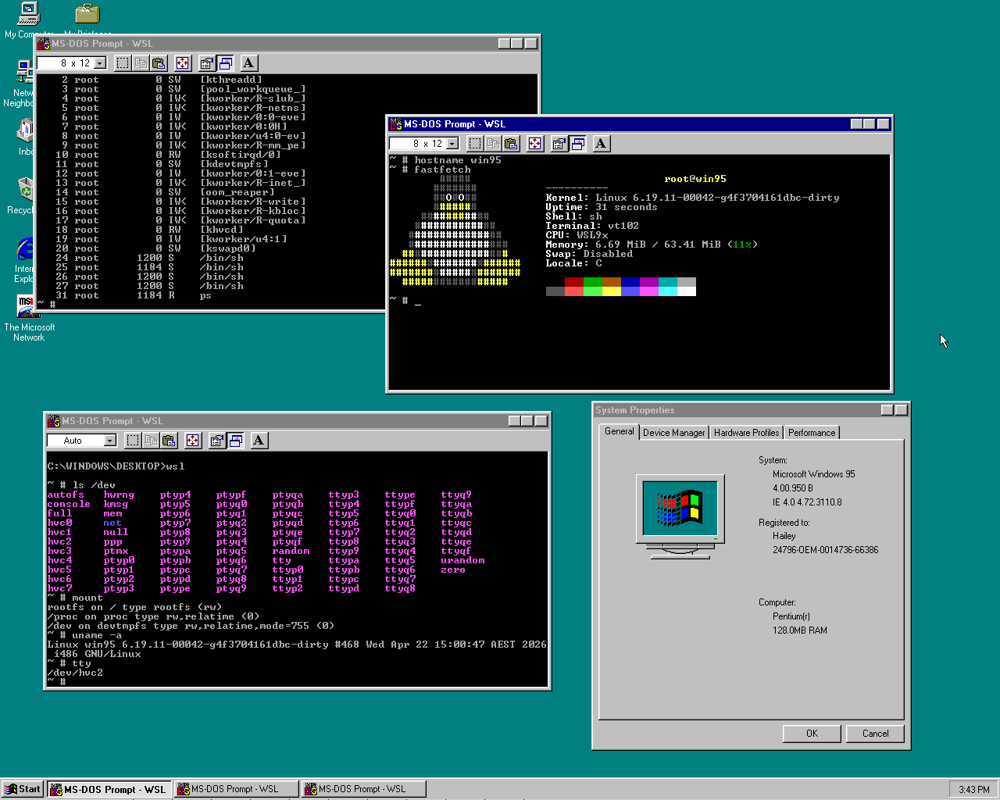

# WSL9x

Windows 9x Subsystem for Linux.

WSL9x runs a modern Linux kernel (6.19 at time of writing) cooperatively inside the Windows 9x kernel, enabling users to take advantage of the full suite of capabilities of both operating systems at the same time, including paging, memory protection, and pre-emptive scheduling. Run all your favourite applications side by side - no rebooting required!

Proudly written without AI.



## Technical details

WSL9x is made up of three components: a patched Linux kernel (see the [`win9x-um-6.19`](https://github.com/haileys/linux/tree/win9x-um-6.19) branch), a VxD driver, and a `wsl.com` client program.

The driver is responsible for the initialisation of WSL9x (see [vxd/wsl9x.asm](vxd/wsl9x.asm) for the driver entry point). It sets up the initial mappings for the kernel code and loads `vmlinux.elf` off disk using DOS interrupts (see [vxd/loader.c](vxd/loader.c) and [vxd/fs.asm](vxd/fs.asm)). The kernel is compiled with a fixed base address of `0xd0000000`.

The driver then starts a new thread in the System VM, allocates a 16 KiB stack for entering Linux on, and drops into an event loop which handles entering the kernel, dispatching IRQs, returning to userspace, and idling. See [vxd/entry.c](vxd/entry.c) for this code.

The driver is also responsible for handling userspace events which must be dispatched to the kernel, currently page faults and syscalls. Syscalls are handled via the general protection fault handler, as Win9x does not have an interrupt descriptor table long enough to install a proper handler for `int 0x80` - the Linux i386 syscall interrupt. Instead, the GPF handler inspects the faulting instruction, and if it's `int 0x80`, advances the instruction pointer as if the interrupt succeeded and dispatches as a syscall to Linux. See [vxd/fault.c](vxd/fault.c) for this code.

The Linux kernel is based on user-mode Linux, but hacked to call Windows 9x kernel APIs instead of posix APIs, and running in ring 0 (supervisor/kernel mode) rather than ring 3 (user mode). Much of the actual integration including context switching lives in the Linux kernel, see [] but there's still vestigal pieces such as the V86 API and console support which live in the VxD. See [linux/arch/um/os-Win95](https://github.com/haileys/linux/tree/win9x-um-6.19/arch/um/os-Win95) for the bulk of the Win9x integration in the kernel code. The entry point called by `vxd/entry.c` is `_start` in [main.c](https://github.com/haileys/linux/tree/win9x-um-6.19/arch/um/os-Win95).

The last piece is the `wsl.com` client. This is a small 16 bit DOS program implemented in [wsl/wsl.asm](wsl/wsl.asm) which exists to allow WSL9x to use MS-DOS prompts as TTY windows rather than needing to implement something custom.

When `wsl.com` starts, it makes an initial call into the WSL9x V86 API ([vxd/v86_api.asm](vxd/v86_api.asm)) to claim an unused console and notify WSL9x that output for that console should be dispatched to it. Then it drops into an event loop waiting for an IRQ and attempting to read from the keyboard when interrupted. The top of this event loop also serves as a synchronisation point for the console driver ([vxd/console.c](vxd/console.c)) - when output from Linux is ready, it schedules an event and executes `int 0x29` in the context of the MS-DOS VM to output chars to the DOS window. This interrupt is also where an ANSI driver for DOS such as NNANSI is able to intercept the terminal output to implement ANSI escape codes.

## Building and running

* You will need a cross toolchain targeting `i386-linux-musl` on PATH. Use [musl-cross-make](https://github.com/richfelker/musl-cross-make) to build one

* You will need the Open Watcom v2 toolchain for building the Windows components

* Build a patched Linux kernel from my [`win9x-um-6.19` branch](https://github.com/haileys/linux/tree/win9x-um-6.19)

   ```sh-session
   $ make defconfig ARCH=um SUBARCH=i386 KBUILD_DEFCONFIG=win9x
   $ make vmlinux ARCH=um SUBARCH=i386 -j $(nproc)
   ```

* Set env vars appropriately for the WSL9x build, in particular you will need to point `WATCOM` and `LINUX` at the right places. See `.envrc.example` for an example

* You will need a hard drive image `hdd.base.img` with Windows 9x pre-installed

* Run `make` - this will produce a new `hdd.img` with WSL9x ready to go.

* Run `wsl` at the MS-DOS prompt to open a pty. If you'd like to use ANSI colours, make sure you have an appropriate driver loaded before running `wsl`. [`nnansi.com`](https://www.kegel.com/nansi/) is a good option.

## License

GPL-3
